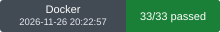
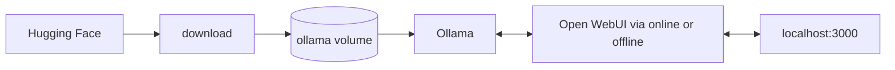

# Local AI Ferry

[](docs/verification-record.md#2026-11-28-184625-0100--test-badge-run)&nbsp;&nbsp;&nbsp; This is software not production-ready - use for testing only.

[](docs/verification-record.md#2026-11-28-184625-0100--test-badge-run)
[](docs/verification-record.md#2026-11-28-184625-0100--test-badge-run)
[](docs/verification-record.md#2026-11-28-184625-0100--test-badge-run)
[](docs/verification-record.md#2026-11-28-184625-0100--test-badge-run)

Local AI Ferry prepares and runs local AI deployments and transfers them to
offline or air-gapped machines (web-connected usage is also supported). 
Its `loaf` CLI runs Ollama and Open WebUI with Docker Compose on Debian or
Debian in WSL2. It uses NVIDIA acceleration by default and also supports CPU
inference.

Prepare a deployment on a connected machine with the [Quick Setup](#quick-setup),
then move it with `loaf backup` and restore the backup folder on the offline
host.

[Backup and recovery](docs/transfer.md#debian-restore)

## Quick Setup

On Debian amd64, the release executable includes Python and the deployment
files. On Debian 12 or 13, the Debian package installs `loaf` as a system
application instead.
Run `loaf setup` to prepare the default configuration. If you
copied a backup, follow setup with `loaf restore`.

[Debian package](docs/installation.md#debian-package) ·
[Download and bootstrap](docs/installation.md#standalone-executable)

### Setup from source

Prepare a connected Debian host with Python 3.10 or newer. The deployment
needs Docker Engine, Compose 2.26.1 or newer, and Buildx. On Debian 12 or 13,
setup can install Docker as described below. For GPU inference, install NVIDIA
driver 580 or newer on the serving host, or
[select the CUDA 12 build](docs/configuration.md#select-an-ollama-build-recipe)
for driver 550 or newer.

From the checkout root, run setup to install the launcher and prepare its
offline installation files.

```bash
PYTHONPATH=python-package/src python3 -m loaf setup
```

Setup installs `loaf` into `.venv`, caches Python wheels and prepares the NVIDIA
Toolkit installers under the Git-ignored `install-cache/` directory. Then
activate the virtualenv with `source .venv/bin/activate`, or run `./loaf` from
the checkout root as below. On Debian 12 or 13, add the `docker-deps` part,
`setup all docker-deps`, to prepare and install Docker Engine, its CLI,
Compose, and Buildx. Configure the NVIDIA container runtime before starting GPU
inference.

The optional terminal server gives models a terminal in a container per chat.
It stays off until `[terminal_server] enabled = true` and needs a bearer key
from `./loaf setup terminal-server-key`.

Build the images, download the selected models, and start offline serving.

```bash
./loaf build
./loaf download
./loaf run offline
```

On a preparation machine without NVIDIA GPU access, use
`./loaf run offline --cpu` or `./loaf run online --cpu`.
Test a chat on CPU and then back up the same deployment for the GPU target.

Use `./loaf upgrade` in place of `build` to refresh upstream images.
Edit `config/config.ini` for deployment settings or `config/models.ini` for
the model selection.

Open the printed WebUI address, which defaults to **http://localhost:3000**.
With the default settings, create the first admin account and send a test
message to **Granite-4.0-H-350M**.

Once the test succeeds, create the transfer archive.

```bash
./loaf backup
```

Backup saves a folder in `backup/` and prints the command that resumes
serving.

[Debian host setup](docs/debian.md) · [WSL2 setup](docs/debian.md#debian-in-wsl2) ·
[Setup parts](docs/cli-help.md#setup) · [Debian setup](docs/debian.md#install-the-loaf-command) ·
[Terminal server setup](docs/terminal-server.md#enable-and-connect) ·
[CPU serving](docs/launcher.md#serve-on-cpu) · [Model selection](docs/launcher.md#select-models) ·
[Local configuration](docs/configuration.md#project-configuration) ·
[WebUI settings](docs/configuration.md#webui-settings) · [What a backup holds](docs/transfer.md) ·
[backup options](docs/cli-help.md#backup)

### If a command fails

Fix the reported issue and retry the command that failed. Docker and Ollama
can reuse completed layers and model files.
Use `./loaf -v run offline` to include the exact Compose commands in the output.

| Failure | Where to check |
| --- | --- |
| Docker socket or Compose error | Check `docker version` and `docker compose version`. [Docker access](docs/debian.md#docker-access) |
| Python, toolkit, or build error | Check the host prerequisites and Buildx. [Debian host setup](docs/debian.md) |
| Model download or export fails | Check network access and the selected model INI. [Model troubleshooting](docs/troubleshooting.md#downloads-and-selection-files) |
| Offline services fail to start | Run `./loaf status`. Check [GPU access](docs/troubleshooting.md#gpu-access) and [import logs](docs/troubleshooting.md#imports-and-startup). |
| WebUI is unreachable | Use the printed address and check the configured port. [Browser connection](docs/troubleshooting.md#browser-connection) |

Use the [disconnected installation guide](docs/installation.md#disconnected-debian-installation)
when starting from a prepared archive.

## Commands and shared model store

`loaf --help` lists the commands and `loaf COMMAND --help` their options. The
[command reference](docs/cli-help.md) explains every command and option.



All Ollama services share one volume, so one serving profile runs at a time;
`loaf run` switches between them. `loaf` works on the current directory. The
Python source and [deployment data](python-package/src/loaf/data/) live in
`python-package/`.

[Failure handling](docs/launcher.md#failure-and-concurrency-behavior) ·
[Separate namespaces](docs/launcher.md#run-a-separate-namespace)

## Choose models and context

The default selection is IBM's Granite 4.0 H 350M in Q4_K_M, a 223 MB chat
model that can call tools.

**Context matters:** the server defaults to **16384 tokens**, and the Qwen3
examples need an explicit `num_ctx`.

[Model selection](docs/launcher.md#select-models) ·
[Example lists for 6, 8 and 16 GB of VRAM](docs/models.md) ·
[WebUI settings](docs/configuration.md#webui-settings)

## Data, stopping and transfer

The [storage table](docs/configuration.md#services-and-storage) lists the
volumes with the models, the Open WebUI accounts and chats and the terminal
user folders. `loaf stop` stops the deployment, and `loaf docker` lists or
removes its Docker resources. To move computers, back up and restore the
deployment as [the transfer guide](docs/transfer.md#debian-restore) describes.

[Offline behavior](docs/configuration.md#networking-and-offline-operation)

## Guides

| Guide | What you will find |
| --- | --- |
| [Installation](docs/installation.md) | Source checkout, standalone executable, Debian package and disconnected installation |
| [Debian](docs/debian.md) | Host preparation: NVIDIA driver, Docker, Docker access, WSL2 and SSH browser access |
| [Serving and model selection](docs/launcher.md) | Model selection, serving modes, containers, namespaces and failure handling |
| [Models](docs/models.md) | 16 GB VRAM/8 GB VRAM specifiers, sizes and resource guidance |
| [Configuration](docs/configuration.md) | Settings layers, image recipes, WebUI, networking and storage |
| [Backup and transfer](docs/transfer.md) | Full Debian deployment recovery and model-only archives |
| [Upgrade](docs/upgrade.md) | New releases of each installation channel and of the terminal server, and the old deployment names |
| [Terminal server setup](docs/terminal-server.md) | Optional per-user Open Terminal workspaces, credentials and acceptance checks |
| [Host integrations](docs/integrations.md) | systemd unit, Continue for VS Code and Open WebUI Tether |
| [Local network access](docs/local-network.md) | Publish or remove LAN access on native Debian and Debian in WSL 2 |
| [Troubleshooting](docs/troubleshooting.md) | Context errors, GPU access, imports and connection checks |
| [CLI reference](docs/cli-help.md) | Every command and its options, the one place that explains them |
| [Architecture](docs/instructions/architecture.md) | Launcher, CPU and GPU serving, Compose networks, Open Terminal and transfer design |
| [Verification guide](docs/verification.md) | Unit, Docker and GPU checks, compact images and release handoff |
| [Verification record](docs/verification-record.md) | Dated test results |
| [Releases](docs/releases.md) | Version tags, GitHub and Gitea drafts, and release assets |
| [Development specification](docs/instructions/development.md) | Pending validation and development work |
| [Development record](docs/development-record.md) | Dated implementation milestones |
| [Problems](docs/instructions/problems.md) | Problems discovered that are still open. Decisions will be recorded until resolved in [development.md](docs/instructions/development.md) |

## Development disclosure

Codex in VS Code assisted with implementation and verification. The author
guided the system design and reviewed the functional behavior of the Docker
Compose deployment and the `loaf` CLI.

- Development uses one of the following models:
  + ChatGPT 6.2 Sol with 'Extra High' reasoning effort.
  + Claude Opus 5.5 with "Extra High" reasoning effort.

- Final verification and testing before each release use:
  + ChatGPT 6.2 Sol with 'Max' reasoning effort.
  + Claude Opus 5.5 with "Max" reasoning effort.

## Support and licensing

For help with an existing deployment, see the [troubleshooting guide](docs/troubleshooting.md).
See [Contributing](CONTRIBUTING.md) for bug reports and changes, and the
[security policy](SECURITY.md) for vulnerability reports.

The Local AI Ferry source is distributed under the BSD 3-Clause license.
Third-party components carry their own license terms.

[Project license](LICENSE.txt) · [Third-party notices](THIRD_PARTY_NOTICES.txt) ·
[Standalone license](docs/releases.md#standalone-license)

## Badges refresh

Run `loaf test -v --badges` to refresh the badges for the groups that run.

[Test groups and GitHub Actions](docs/verification.md#readme-test-badges)
