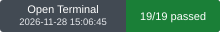
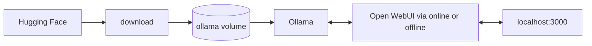

# Local AI Ferry

[](docs/verification-record.md#2026-11-26-202257-0100--test-badge-run)&nbsp;&nbsp;&nbsp; This is software not production-ready - use for testing only.

[](docs/verification-record.md#2026-11-26-202257-0100--test-badge-run)
[](docs/verification-record.md#2026-11-26-202257-0100--test-badge-run)
[](docs/verification-record.md#2026-11-26-202257-0100--test-badge-run)
[](docs/verification-record.md#2026-11-26-202257-0100--test-badge-run)

Local AI Ferry prepares and runs local AI deployments and transfers them to
offline or air-gapped machines (web-connected usage is also supported). 
Its `loaf` CLI runs Ollama and Open WebUI with Docker Compose on Debian or
Debian in WSL2. It uses NVIDIA acceleration by default and also supports CPU
inference.

On the connected machine, run `loaf setup`, `loaf build`, and `loaf download`
to prepare the deployment. Run `loaf online` to test it. Use
`loaf online --cpu` on a machine without NVIDIA GPU access.

To move the deployment offline, run `loaf backup` and copy the entire backup
folder to the destination. From the backup folder, run `./loaf setup`,
`./loaf restore` and `./loaf offline`. The folder becomes the project, and
the backup moves to its `backup/` directory.
[Backup recovery](docs/transfer.md#debian-restore)

## Development disclosure

Codex in VS Code assisted with implementation and verification. The author
guided the system design and reviewed the functional behavior of the Docker
Compose deployment and the `loaf` CLI.

- Development uses one of the following models:
  + ChatGPT 6.2 Sol with 'Extra High' reasoning effort.
  + Claude Opus 5.5 with "Extra High" reasoning effort.

- Final verification and testing before each release use:
  + ChatGPT 6.2 Sol with 'Max' reasoning effort.
  + Claude Opus 5.5 with "Max" reasoning effort.

## Quick Setup

On Debian amd64, the release executable includes Python and the deployment
files. On Debian 12 or 13, the Debian package installs `loaf` as a system
application instead. [Debian package](docs/installation.md#debian-package)
Run `loaf setup` to prepare the default configuration. If you
copied a backup, follow setup with `loaf restore`. [Download and bootstrap](docs/releases.md#run-the-executable)

### Setup from source

Prepare a connected Debian host with Python 3.10 or newer. The deployment
needs Docker Engine, Compose 2.26.1 or newer, and Buildx. On Debian 12 or 13,
setup can install Docker as described below. For GPU inference, install NVIDIA
driver 580 or newer on the serving host, or
[select the CUDA 12 build](docs/configuration.md#select-an-ollama-build-recipe)
for driver 550 or newer.
[Debian host setup](docs/debian.md) · [WSL2 setup](docs/debian.md#debian-in-wsl2)

From the checkout root, run setup to install the launcher and prepare its
offline installation files.

```bash
PYTHONPATH=python-package/src python3 -m loaf setup
```

Setup installs `loaf` into `.venv`, caches Python wheels and prepares the NVIDIA
Toolkit installers under the Git-ignored `install-cache/` directory. On Debian
13, add `--with-docker-deps` to prepare and install Docker Engine, its CLI,
Compose, and Buildx. Configure the NVIDIA container runtime before starting GPU
inference. [Debian setup](docs/debian.md#install-the-loaf-command)

Setup creates the terminal bearer key if it is missing. To prepare only the
key, run `loaf setup --terminal-server-key`. The checkout enables the terminal
server. [Terminal server setup](docs/terminal-server.md#enable-and-connect)

Build the images, download the selected models, and start offline serving.

```bash
./loaf build
./loaf download
./loaf offline
```

On a preparation machine without NVIDIA GPU access, use
`./loaf offline --cpu` or `./loaf online --cpu`.
Test a chat on CPU and then back up the same deployment for the GPU target.
[CPU serving](docs/launcher.md#serve-on-cpu)

Use `./loaf upgrade` in place of `build` to refresh upstream images.
Edit `config/config.ini` for deployment settings or `config/models.ini` for
the model selection.
[Model selection](docs/launcher.md#select-models)
[Local configuration](docs/configuration.md#project-configuration)

Open the printed WebUI address, which defaults to **http://localhost:3000**.
With the default settings, create the first admin account and send a test
message to **Granite-4.0-H-350M**. [WebUI settings](docs/configuration.md#webui-settings)

Once the test succeeds, create the transfer archive.

```bash
./loaf backup
```

Backup stops the project's services and saves the archive in `backup/` by
default. Backup includes the locally available Open Terminal image. Use
`loaf backup --no-terminal-server` to skip the image. Set
`[terminal_server] include_in_backup = true` to include terminal user volumes
and the bearer key.
Run `./loaf offline` to resume serving, adding `--cpu` on a CPU host.
[Backup and recovery](docs/transfer.md)

### If a command fails

Fix the reported issue and retry the command that failed. Docker and Ollama
can reuse completed layers and model files.
Use `./loaf -v offline` to include the exact Compose commands in the output.

| Failure | Where to check |
| --- | --- |
| Docker socket or Compose error | Check `docker version` and `docker compose version`. [Docker access](docs/debian.md#docker-access) |
| Python, toolkit, or build error | Check the host prerequisites and Buildx. [Debian host setup](docs/debian.md) |
| Model download or export fails | Check network access and the selected model INI. [Model troubleshooting](docs/troubleshooting.md#downloads-and-selection-files) |
| Offline services fail to start | Run `./loaf status`. Check [GPU access](docs/troubleshooting.md#gpu-access) and [import logs](docs/troubleshooting.md#imports-and-startup). |
| WebUI is unreachable | Use the printed address and check the configured port. [Browser connection](docs/troubleshooting.md#browser-connection) |

Use the [disconnected installation guide](docs/installation.md#disconnected-debian-installation)
when starting from a prepared archive.

## Commands and shared model store

| Mode | What it does |
| --- | --- |
| `setup` / `install` | Prepare the deployment and its terminal key. Use `--terminal-server-key` for key setup alone. `--test-local-repository` creates a small APT repository for `apt` in chat containers. `setup tests` caches and installs the test packages. [Setup options](docs/cli-help.md#setup) |
| `link-docker-project` | Create a `docker-project` symlink to the packaged Compose file, Dockerfiles, and default configuration. [Direct Compose commands](docs/launcher.md#link-the-docker-project) |
| `integration` | Print a systemd unit, Continue YAML, or Tether installation instructions. [Host integrations](docs/installation.md#host-integrations) |
| `build` / `upgrade` | Build the local images. Upgrade refreshes upstream base images first. |
| `package` | Build the standalone executable (`binary`) or the Debian package (`debian`) from the source checkout into `dist/`. [Local builds](docs/releases.md#build-and-check-locally) |
| `clean` | Remove temporary files and the runtime cache. Add `--full` to clear generated installation files too. [Cleanup](docs/launcher.md#clean-generated-files) |
| `download` | Download selected models using the downloader. |
| `online` / `offline` | Start Ollama and WebUI with the selected network profile. Add `--cpu` for CPU inference. |
| `backup` / `restore` | Select any of `source`, `config`, `installers`, `images`, `models`, `webui` and `terminal`, or the aliases `project` and `volumes`. `models` alone transfers the model store. [Archive types](docs/transfer.md#select-archive-types) |
| `backup --verify` | Check the archive members and the bundled launcher, list the types, and report saved image platforms without Docker. |
| `version` / `docs` | Show the release and installation, or read the bundled guides and manual page. [Bundled guides](docs/launcher.md#read-the-bundled-guides) |
| `status` / `stop` | Check deployment readiness and list containers, or stop and remove containers across all profiles. [Keep stopped containers](docs/launcher.md#stop-and-remove-containers) |
| `test` | Run the checkout's test suite. [Verification guide](docs/verification.md) |



The launcher switches profiles and prevents overlapping runs in this checkout.
All Ollama services share a volume. Run one profile at a time.
All services have `scale: 1`. See [launcher options and failure handling](docs/launcher.md).
`loaf` defaults to the **current directory**. Use `--project-dir PATH` to select
another checkout or a directory with a `docker-project` link. The Python source
and [deployment data](python-package/src/loaf/data/) live in `python-package/`.
Run `loaf --help` for the command list and `loaf COMMAND --help` for its flags.
[Command reference](docs/cli-help.md)
Use `--version VERSION` to keep a deployment's images, volumes, and backups
separate. [Versioned deployments](docs/launcher.md#run-a-versioned-deployment)

## Choose models and context

The default INI section `[models.default]` selects IBM's Granite 4.0 H 350M in
Q4_K_M, a 223 MB chat model that can call tools. Add a `[models.<name>]` section with a `model` value
for each model you want to use. Those sections replace the default selection.
Add `name` to show the model under that readable name only. Choose a different
INI with `--models-file` or select another settings directory with `--config-dir`.
[Selection syntax](docs/launcher.md#select-models)

| Example list | Intended hardware | Choices |
| --- | --- | --- |
| [16 GB VRAM](config/model-examples/models.16gb.ini) | GPUs with about 16 GB of VRAM | Qwen3-14B, Coder-14B, Ministral-3B |
| [8 GB VRAM](config/model-examples/models.8gb.ini) | GPUs with about 8 GB of VRAM | Qwen3-4B, Coder-7B, Ministral-3B |
| [6 GB VRAM](config/model-examples/models.6gb.ini) | GPUs with about 6 GB of VRAM | Ministral-3B |

Pass the model file to `loaf download`. [Example commands and hardware estimates](docs/models.md)

**Context matters:** the server defaults to **16384 tokens**. Set `num_ctx=16384`
explicitly for the Qwen3 examples to override their larger preset. Start with
4096 output tokens so reasoning has room to finish. [WebUI settings](docs/configuration.md#webui-settings)
explains context precedence and sampling.

## Data, stopping and transfer

| Volume | Contents |
| --- | --- |
| `ollama`, mounted at `/ollama` | `models/`: weights, projectors and manifests; `config/`: exported Modelfiles |
| `open-webui`, mounted at `/app/backend/data` | Accounts, chats, settings and caches |
| Terminal user volume, the account's folder at `/home/user` | Persistent files and settings shared by the account's chats. [Workspace storage](docs/terminal-server.md#offline-transfer-and-shutdown) |
| Saved chat terminal volume at `/home/chat` | Files private to a chat until it is deleted. [Files tab](docs/terminal-server.md#use-the-terminal-from-a-model) |

Backend startup imports all saved `.model` files. Models and exports persist
after you remove an entry from the selection file.

Stop the deployment and remove its service containers with `loaf stop`. Use
`loaf stop -n` to keep the stopped containers and their logs.

```bash
loaf stop
```

To move computers, run `loaf backup` and transfer the resulting
`backup/YYYYMMDD-HHMM_local-ai-ferry/` folder. On the destination, enter
that folder and run `./loaf setup` followed by `./loaf restore`. The folder
becomes the project.
[Offline transfer](docs/transfer.md#debian-restore)

Offline startup uses local images and models. Ollama is on an internal network;
WebUI also has a bridge for localhost access. Its offline flags suppress automatic
downloads, while a physically disconnected host provides full network isolation.
See [configuration and offline behavior](docs/configuration.md).

## Guides

| Guide | What you will find |
| --- | --- |
| [Installation](docs/installation.md) | Installation steps |
| [Open WebUI Tether](docs/tether.md) | Desktop installation and connection to a running deployment |
| [Debian](docs/debian.md) | Native Docker/NVIDIA setup, startup and SSH browser access |
| [Local network access](docs/local-network.md) | Publish or remove LAN access on native Debian and Debian in WSL 2 |
| [CLI overview](docs/cli.md) | Find commands and help |
| [CLI reference](docs/cli-help.md) | Every command and its flags |
| [Launcher](docs/launcher.md) | Installation, model selection, serving and failure handling |
| [Models](docs/models.md) | 16 GB VRAM/8 GB VRAM specifiers, sizes and resource guidance |
| [Configuration](docs/configuration.md) | Volumes, environment, context, networking and extra features |
| [Backup and transfer](docs/transfer.md) | Model-only archives and full Debian deployment recovery |
| [Development specification](docs/instructions/development.md) | Pending validation and development work |
| [Development record](docs/development-record.md) | Dated implementation milestones |
| [Architecture](docs/instructions/architecture.md) | Launcher, CPU and GPU serving, Compose networks, Open Terminal and transfer design |
| [Terminal server setup](docs/terminal-server.md) | Optional per-user Open Terminal workspaces, credentials and acceptance checks |
| [Troubleshooting](docs/troubleshooting.md) | Context errors, GPU access, imports and connection checks |
| [Verification guide](docs/verification.md) | Unit, Docker and GPU checks, compact images and release handoff |
| [Verification record](docs/verification-record.md) | Dated test results |
| [Releases](docs/releases.md) | Version tags, GitHub and Gitea drafts, and release assets |

## Support and licensing

For help with an existing deployment, see the [troubleshooting guide](docs/troubleshooting.md).
See [Contributing](CONTRIBUTING.md) for bug reports and changes, and the
[security policy](SECURITY.md) for vulnerability reports.

The Local AI Ferry source is distributed under the BSD 3-Clause license.
Third-party components carry their own license terms.
[Project license](LICENSE.txt) · [Third-party notices](THIRD_PARTY_NOTICES.txt) · [Standalone license](docs/releases.md#standalone-license)

## Badges refresh

Run `loaf test -v --badges` to refresh the badges for the groups that run.
[Test groups and GitHub Actions](docs/verification.md#readme-test-badges)
